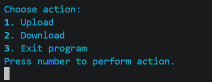
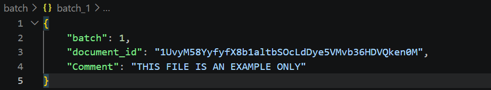
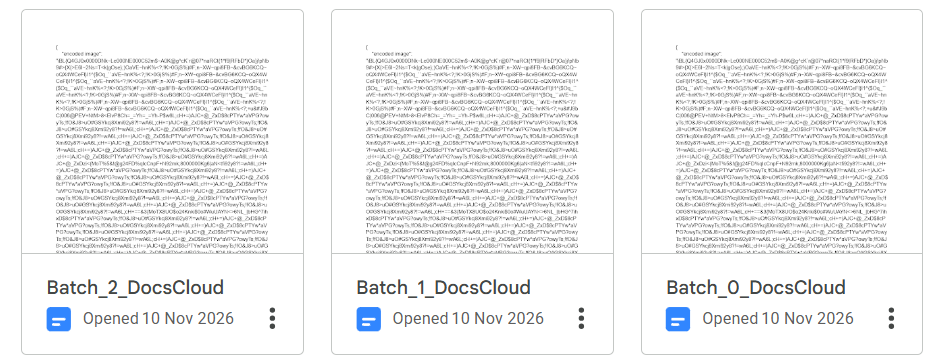
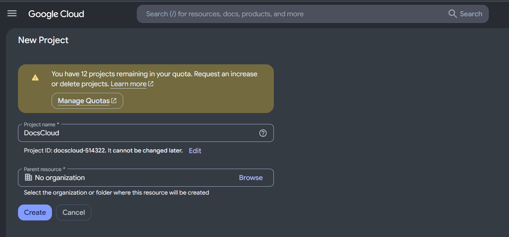
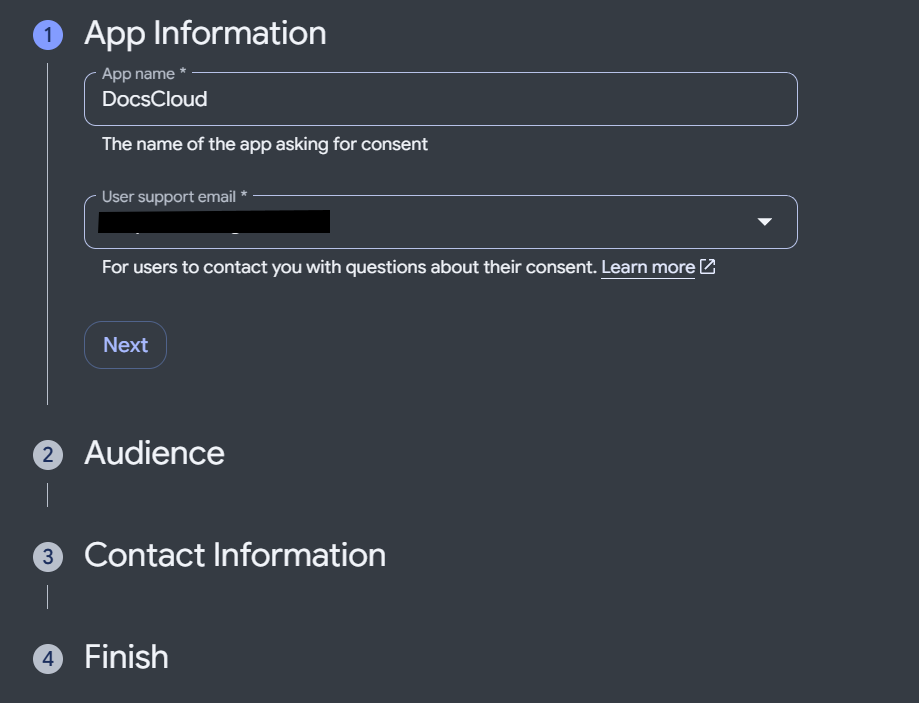
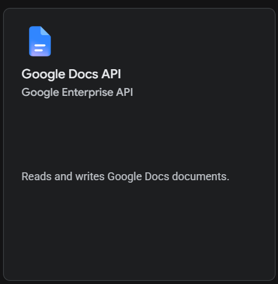

### DocsCloud
DocsCloud is a tool used to store images, audio, video or really any file in google docs, essentially using google docs as your own cloud storage. The purpose of this is to take advantage of a company or schools unlimited google docs storage, and use it to our benefit, rather than just storing documents.

## Description
DocsCloud utilises Google Docs as cloud storage, through encoding files into base85. Then, using Google Docs API, the files are sent in a json format to a document. This document's ID is saved, and can be accessed in the future.

## Screenshots

## Getting Started

### Installation
1. DocsCloud can be installed through one of two methods:
    -  Go to "https://github.com/zeept1234/DocsCloud", click releases, and install the zip file. Unzip the file and move the folder to a directory of your choice (e.g. C:/documents/DocsCloud). 
    -  Alternatively, navigate to a directory of your choice and open a terminal window (right click, click "Terminal" or, open Terminal and run "cd C:/path/to/whereYouWantYourDocsCloudFolder"). Then, run "git clone https://github.com/zeept1234/DocsCloud"

### Dependancies
- Windows 11 (should work on windows 10 - not guaranteed)
- Python 3.12+
- Install requirements.txt (see creating a virtual environment)
- Google API and cloud account (see setting up google API)

#### Creating a Virtual Environment
1. Run "python -m venv .venv" to create a virtual environment named ".venv"
2. Run ".venv\Scripts\Activate.ps1" to activate the virtual environment
3. Run "pip install -r requirements.txt" to install the requirements for this project

#### Setting up Google API
See "https://developers.google.com/workspace/docs/api/quickstart/python" for a more in depth guide.
1. Access the Google Cloud Console and create a project via "https://console.cloud.google.com/projectcreate" 
2. Name the project anything, and set organisation to "No organization"
3. Configure the OAuth settings via "https://console.cloud.google.com/auth/branding?project=docscloud-514322"
4. Click "Get started" and fill out "App Information" (It doesn't matter what you put, only you will be using it) 
5. For "Audience", select "External". For "Contact Information", enter your email. For "Finish", click "I agree", then "continue". Finally, press "Create"
6. Access the clients menu via "https://console.cloud.google.com/auth/clients" or the "Clients" section on the left side of the Google Cloud Console
7. Click "Create Client". Set "Application type" to "Desktop app" and "Name" to anything ("Name" is only shown to you"). Click "Create"
8. After clicking create, popup should appear. Click "Download JSON" (You may need to scroll down to see it) to download a JSON file, named "client_secret" followed by a string of numbers and letters. Rename this file (without changing the file extension) to "credentials.json"
9. Put "credentials.json" into the DocsCloud folder
10. Navigate back to the "Audience" section and click "Add users" (You may need to scroll down to see it). Enter your email (same one as before) and click "Save"
11. Open a terminal in the DocsCloud directory (open the folder, right click, click "Terminal" or, open Terminal and run "cd C:/path/to/docsCloud"), then run "python token_setup.py". A web page should open, select or sign in to your email (same one as before). If you get a "Google hasn't verified this app" page, click "continue". Then, click "Continue" again to give DocsCloud access to your google Docs. The page will close and "token.json" should appear in the DocsCloud directory
12. Navigate to the "APIs and Services" page of the Google Cloud console via "https://console.cloud.google.com/apis" or the "APIs and Services" button in the "Quick access" of your Google Cloud console project homepage. Click on "Library", located on the left bar.
13. In the search bar, marked "Search for APIs & Services", type "Google Docs API", then click enable
12. Google API is now set up

### Executing the program
Ensure dependencies are installed and google API is set up before continuing
1. Activate the virtual environment by running ".venv\Scripts\Activate.ps1" in a terminal pointing to the docsCloud directory. The terminal should say "(.venv) PS C:path/to/DocsCloud>"
2. Run "python main.py" to execute "main.py", the terminal should show the DocsCloud main menu.